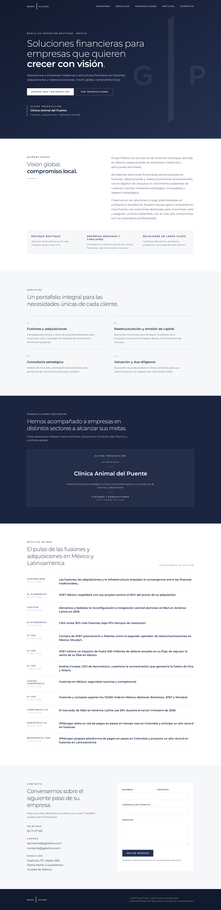

# Grupo Platino — Landing page

Sitio web de **Grupo Platino**, banca de inversión boutique en México especializada en empresas medianas y estructuras familiares.

- **Stack:** Vite + React + TypeScript + Tailwind CSS v4. Tipografía Montserrat (autoalojada vía `@fontsource-variable/montserrat`).
- **Sitio estático:** se despliega en GitHub Pages, Vercel o Netlify (configuración incluida).
- **Contenido dinámico:** las secciones de *Transacciones* y *Noticias de M&A* se leen en el navegador desde `public/data/deals.json` y `public/data/news.json`.
- **Agente mensual:** una GitHub Action actualiza las noticias cada mes y abre un Pull Request.



## Desarrollo local

Requiere Node.js 20 o superior.

```bash
npm install
npm run dev        # servidor local en http://localhost:5173
npm run build      # valida datos, revisa tipos y genera dist/
npm run preview    # sirve dist/ localmente
```

## Estructura

```
public/
  assets/             logos (horizontal y monograma, versiones navy/blanco)
  data/deals.json     transacciones (tombstones)
  data/news.json      noticias de M&A (las actualiza el agente)
  og-image.png        imagen para redes sociales
src/
  content.ts          textos de servicios, contacto y pilares
  components/         Header, Hero, About, Services, Deals, News, Contact, Footer
  lib/data.ts         carga de JSON en runtime + formato de fechas
scripts/
  update-news.mjs     agente de noticias (RSS / Google News RSS)
  news-config.json    consultas, feeds extra, máximo de items y antigüedad
  add-deal.mjs        agrega una transacción a deals.json
  validate-data.mjs   valida ambos JSON (corre en cada build)
.github/workflows/
  ci.yml              build en PRs
  deploy-pages.yml    publicación en GitHub Pages al hacer merge a main
  monthly-update.yml  agente mensual
```

## Cómo agregar una transacción

La más reciente (por fecha) aparece primero y destacada como **Última transacción**. No se muestran cifras ni montos salvo que se confirmen explícitamente.

**Opción A — editar el JSON.** Agrega un objeto a `public/data/deals.json`:

```json
{
  "id": "nombre-cliente-2026-10",
  "client": "Nombre del cliente",
  "sector": "Sector",
  "type": "Fusiones y adquisiciones",
  "date": "2026-10",
  "description": "Asesoría financiera y estratégica a Nombre del cliente en su transacción de fusiones y adquisiciones.",
  "url": "https://opcional.com/comunicado"
}
```

`id`, `client`, `sector`, `type`, `date` (formato `AAAA-MM`) y `description` son obligatorios; `url` es opcional.

**Opción B — por línea de comandos:**

```bash
npm run add:deal -- --client "Nombre del cliente" --sector "Sector" --date 2026-10
```

**Opción C — desde GitHub:** *Actions → Actualización mensual → Run workflow* y captura cliente, sector y mes. El flujo agrega la transacción, actualiza noticias y abre un PR.

## Agente mensual de noticias

`scripts/update-news.mjs` consulta Google News RSS (y los feeds RSS extra que definas en `scripts/news-config.json`) con búsquedas de M&A en México, LatAm y mid-market; filtra por relevancia y antigüedad (60 días por defecto), elimina duplicados por URL y por títulos similares, y conserva un máximo de **12** noticias con `title`, `source`, `date` y `url`.

```bash
npm run update:news
```

- **Programación:** `monthly-update.yml` corre el día 1 de cada mes (14:00 UTC) y bajo demanda con `workflow_dispatch`. Abre un PR (`bot/actualizacion-mensual`) con los cambios en `public/data/*.json`; al hacer merge, `deploy-pages.yml` republica el sitio.
- **Sin API keys:** funciona sin ningún secret.
- **Resúmenes con LLM (opcional):** si defines el secret `OPENAI_API_KEY` o `ANTHROPIC_API_KEY`, las noticias nuevas reciben un `summary` de una oración basado solo en el titular (modelos configurables con `OPENAI_MODEL` / `ANTHROPIC_MODEL`). Si falla, la noticia se publica sin resumen.
- Si ningún feed responde, el script termina con error y no modifica `news.json`.

**Ajustes necesarios en el repositorio** (una sola vez):

1. *Settings → Actions → General → Workflow permissions*: activar **Read and write permissions** y **Allow GitHub Actions to create and approve pull requests**.
2. *Settings → Pages → Source*: **GitHub Actions**.

> Los PR creados con el `GITHUB_TOKEN` no disparan otros workflows (p. ej. CI). Si se requiere CI en esos PR, usa un token personal o GitHub App en `monthly-update.yml`.

## Despliegue

| Plataforma | Configuración |
| --- | --- |
| GitHub Pages | `.github/workflows/deploy-pages.yml` (el sitio usa `base: './'`, funciona en subruta y en dominio propio). |
| Vercel | `vercel.json` (build `npm run build`, salida `dist`). |
| Netlify | `netlify.toml` (Node 22, salida `dist`). |

Para usar el dominio `www.gplatino.com`, configúralo en la plataforma elegida; las URL canónicas, `sitemap.xml`, `robots.txt` y metadatos Open Graph ya apuntan a ese dominio.

## Marca

Azul marino `#25314F`, platino `#C9D0DC` como acento y fondos claro/oscuro alternados. Logos en `public/assets/`: el logo blanco se usa sobre fondos oscuros y el navy sobre fondos claros.

## Pendiente por confirmar con el cliente

Los textos actuales se basaron en el sitio actual (https://www.gplatino.com/) y fueron redactados con tono más claro y ordenado. No se pudo usar el PDF mencionado. Falta confirmar:

- [ ] **Textos oficiales:** quiénes somos, visión/misión, descripción de cada servicio y los pilares de la sección “Quiénes somos”.
- [ ] **Teléfono:** el sitio actual muestra `52-11-07-69` (sin lada); confirmar número completo y si debe ser clicable (`tel:`) o con WhatsApp.
- [ ] **Correos:** el sitio actual lista `secretaria@gplatino.com` y `contacto@gplatino.com`; confirmar cuál(es) publicar y cuál recibe el formulario.
- [ ] **Dirección:** Coahuila 117, Depto 205, Roma Norte, Cuauhtémoc (se agregó “Ciudad de México”); confirmar código postal y si se añade mapa.
- [ ] **Transacciones previas:** lista de clientes, sector, mes/año y descripción autorizada para publicar (sin cifras salvo autorización). Hoy solo aparece *Clínica Animal del Puente* (septiembre 2026, sector veterinario, descripción genérica).
- [ ] **Autorización de confidencialidad** de clientes para publicar nombre y logotipo.
- [ ] **Equipo:** nombres, cargos y fotos si se desea una sección de equipo.
- [ ] **Formulario de contacto:** hoy abre el correo del usuario (`mailto:`); decidir si se integra un servicio (Formspree, Netlify Forms, etc.).
- [ ] **Aviso de privacidad** y términos, requeridos si se captan datos.
- [ ] **Dominio, analítica y redes sociales** (LinkedIn, etc.).
- [ ] **Versión en inglés** (si se requiere).
- [ ] **Fuentes/consultas de noticias:** revisar `scripts/news-config.json` y, si se desea, agregar feeds RSS preferidos.
